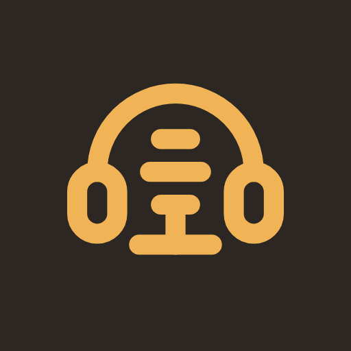
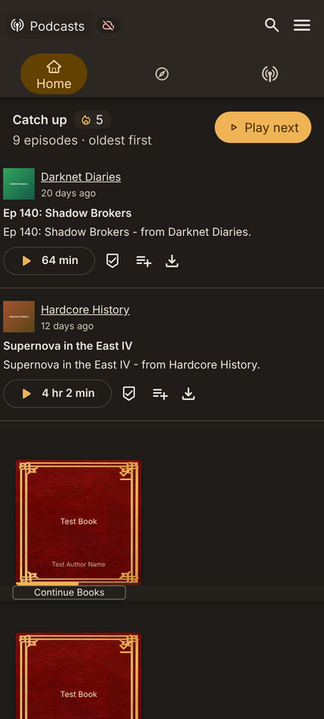
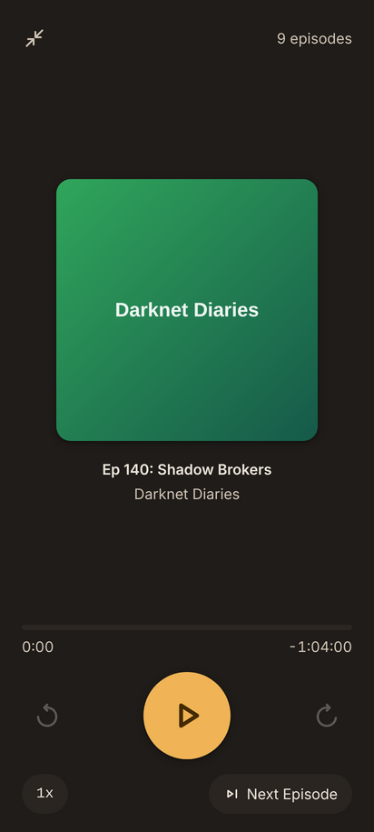
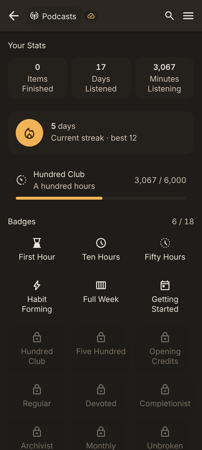
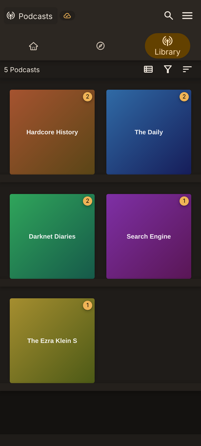

# Podshelf

**A podcast-first player for your own [Audiobookshelf](https://www.audiobookshelf.org) server.**

Catch up on what's new, queue it, take it offline, and listen in the car — on Android.

### [⬇ Download the latest APK](https://github.com/yougotborked/podshelf-app/releases/latest) · [Test builds](https://yougotborked.github.io/podshelf-app/) · [Roadmap](docs/ROADMAP.md)

Catch up · Minimal mode · Stats & badges · Library

---

## What it is

A fork of the [Audiobookshelf mobile app](https://github.com/advplyr/audiobookshelf-app), reworked
around podcast listening rather than audiobooks, with **offline use and Android Auto treated as
primary cases rather than extras**.

Podshelf is a client. **It needs an [Audiobookshelf](https://www.audiobookshelf.org) server to
connect to** and provides no content of its own.

## What's different from upstream

**Podcast workflow**

- **Catch up** — one feed of unplayed episodes across your podcast libraries, oldest first, on the
  home screen.
- **Minimal mode** — the whole app reduced to one play control. No list to browse; it decides what
  is next by reading the library, and finishes a half-heard episode before starting anything new.
- **Per-podcast rules** — exclude a show from the queue, or keep only its newest *N* unplayed
  episodes, so one back catalogue cannot bury everything else.
- **Auto cache unplayed episodes** — downloads them in the background so they are ready without a
  connection.

**Offline, as a first-class state**

- **Disconnect / Continue Offline** — go offline deliberately and keep the normal app around you,
  rather than dropping to a bare file list.
- Reachability is judged by whether the server *answered*, not by whether the radio is up — so
  plane wifi, captive portals and patchy coverage behave sensibly instead of stalling on timeouts.
- Offline, the queue is built from what is actually on disk, so it never offers a stream it cannot
  play.

**In the car and on the lock screen**

- Android Auto browsing and playback with a working queue, skip/seek and playback speed.
- A proper media session, so lock screen, notification, watch and headset controls all work.

**Large screens and foldables**

- Content stops stretching past 600dp, where Android's medium window size class begins.
- **Tabletop posture** — with a foldable propped open and the hinge across the screen, the player
  lays the artwork out above the hinge instead of centring it across the fold.

**Listening stats worth opening**

- Streaks, an 18-badge ladder, and progress toward the next one.

Under the hood this fork has also moved Nuxt 2 → 3, Vuex → Pinia and ExoPlayer2 → Media3.

## Installing

Download the `podshelf-*.apk` from the [latest release](https://github.com/yougotborked/podshelf-app/releases/latest),
or from the [test page](https://yougotborked.github.io/podshelf-app/), which shows the build date
and commit. Every push to `master` publishes both.

- Android will ask you to allow installing from an unknown source the first time.
- These are **debug** builds, signed with the repo's debug key, package id `com.podshelf.app.debug`.
- Android only — iOS is not built or released here.
- It installs **alongside** upstream's Play Store app rather than replacing it.

> **Coming from a build made before the rename?** The application id changed from
> `com.audiobookshelf.app` to `com.podshelf.app`. Android treats that as a different app, so this
> installs alongside the old one rather than upgrading it, and app-private storage does not carry
> over — downloads have to come down again. Listening progress lives on your server, so it survives.

## Documentation

| | |
|---|---|
| [Roadmap](docs/ROADMAP.md) | What is planned, what shipped, and the reasoning behind each |
| [Development](docs/DEVELOPMENT.md) | Building, the checks, screenshots, CI |
| [Tech debt](docs/TECH_DEBT.md) | Deliberate compromises and the condition that clears each |
| [CLAUDE.md](CLAUDE.md) | Codebase constraints — state management, theming, where tests go |
| [Plexamp study](docs/PLEXAMP_STUDY.md) | What a well-loved player does well, and what transfers |
| [Play Store](docs/PLAY_STORE.md) | Release signing and the Play Console process |

## Credits

All of the hard work belongs to [advplyr](https://github.com/advplyr) and the Audiobookshelf
contributors. This is a personal fork tuned to one podcast-heavy listening habit. If you want the
supported app, use upstream:

- Upstream app — [advplyr/audiobookshelf-app](https://github.com/advplyr/audiobookshelf-app)
- Server — [advplyr/audiobookshelf](https://github.com/advplyr/audiobookshelf)
- Project site — [audiobookshelf.org](https://www.audiobookshelf.org)
- Discord — [discord.gg/pJsjuNCKRq](https://discord.gg/pJsjuNCKRq)

Licensed under the same terms as upstream — see [LICENSE](LICENSE).
